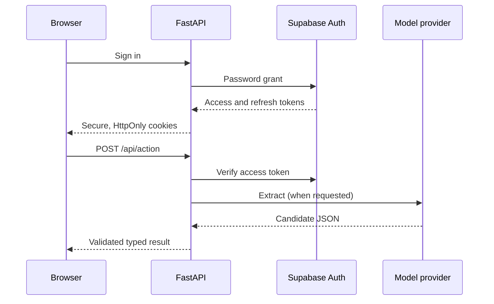

# Deployment

## Hosted web application

`app.py` exports a FastAPI application for Vercel. The `structured-output-agent` Vercel project is connected to the `agent-suite-supabase` resource. The production URL is <https://structured-output-agent.vercel.app/>. The CLI project preset must be `fastapi`; the default `other` preset produces a static 404 deployment.

The browser signs users in with email and password through Supabase Auth. Access and refresh tokens are stored in Secure, HttpOnly, SameSite cookies. Every product action verifies the access token with Supabase. Write requests require a same-origin `Origin` header. The hosted app is stateless; no product database tables are needed.



Environment variables are supplied by the Vercel Supabase integration: `SUPABASE_URL` and `SUPABASE_PUBLISHABLE_KEY` (or `SUPABASE_ANON_KEY`). Add `OPENAI_API_KEY`, and optionally `OPENAI_MODEL` and `OPENAI_BASE_URL`, to Vercel project settings to enable live extraction. Do not expose the Supabase secret/service-role key or the model key to the browser. Configure Supabase Auth email delivery, confirmation redirects, and abuse controls before inviting users at scale. The default built-in email service has tight sending limits.

Release procedure: `uv lock --check`, `ruff check app.py src tests scripts`, `ruff format --check app.py src tests scripts`, `pytest -q`, then `vercel deploy --prod`. Verify `/healthz`, an unauthenticated 401 from `/api/session`, signup confirmation, login, refresh, logout, validation, and live extraction with a real provider account. `scripts/smoke_hosted.py` tests live sign-in, validation, and sign-out with a temporary account; run it only from a trusted operator machine with `SUPABASE_URL` and `SUPABASE_SERVICE_ROLE_KEY` set, and never put that key in the web app. Inspect Vercel runtime logs after each release.

## Local product

Install with `python -m pip install -e .`, then run the command shown in README. The browser binds to `127.0.0.1:8080` by default. `GET /healthz` is a lightweight health endpoint.

## Container

Copy `.env.example` to `.env`, replace every example secret, and keep that file outside Git. Build and run from this repository:

```bash
docker build -t structured-output-agent .
docker run --rm -p 127.0.0.1:8080:8080 --env-file .env structured-output-agent serve --port 8080
```

The image runs as a non-root user. It binds inside the container to `0.0.0.0`; the example publishes only to host loopback. A non-loopback bind requires `AGENT_WEB_TOKEN` of at least 16 characters. The browser asks for that token and sends it to the action endpoint. Put TLS and an authenticated reverse proxy in front of any public deployment.

This product is stateless. Set OPENAI_API_KEY to enable extraction; validation works without it.

## Release checks

Run `ruff check src tests`, `ruff format --check src tests`, and `pytest -q`. Test the browser action path and `/healthz` after deployment. Keep secrets in the deployment platform, monitor failed actions and model/provider errors, and set backups for any mounted data volume.
