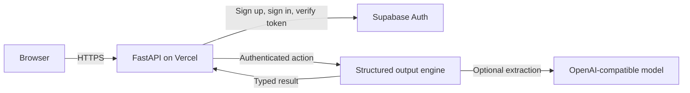
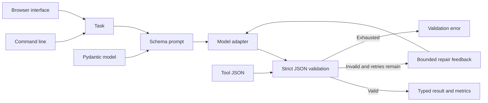

# Structured Output Agent

Validate model JSON with Pydantic, retry malformed responses with concrete validation feedback, and return attempt metrics.

## Quick start

Requires Python 3.11 or newer. From this repository:

```powershell
python -m venv .venv
.\.venv\Scripts\Activate.ps1
python -m pip install -e '.[dev]'
pytest -q
```

On macOS or Linux:

```bash
python3 -m venv .venv
source .venv/bin/activate
python -m pip install -e '.[dev]'
pytest -q
```

For live model calls, set `OPENAI_API_KEY` and optionally `OPENAI_MODEL` and `OPENAI_BASE_URL` as shown in `.env.example`. The test suite uses stubs and needs no model key.

Install the package, then use `structured-output extract "Summarize this support ticket..." --field title:str --field priority:int` to get typed JSON. Use `structured-output validate '{"title":"Bug","priority":2}' --field title:str --field priority:int` to validate locally without a model call. For a browser form, run `structured-output serve --port 8080` and open `http://127.0.0.1:8080`. The browser lets you define `str`, `int`, `float`, or `bool` fields and either extract or validate data.

```python
from pydantic import BaseModel, Field
from structured_output_agent.engine import StructuredOutputAgent
from structured_output_agent.llm import OpenAICompatibleLLM


class Invoice(BaseModel):
    amount: float = Field(gt=0)
    currency: str = Field(pattern=r"^[A-Z]{3}$")


result = StructuredOutputAgent(OpenAICompatibleLLM.from_env(), Invoice).run(
    "Extract: USD 42.50"
)
print(result.value, result.attempts, result.validation_failures)
```

## Architecture

The hosted application uses Supabase Auth for email/password sessions. Its API verifies each access token with Supabase before running a product action.





| Component | Responsibility |
|---|---|
| Schema boundary | Pydantic validates model and tool JSON with strict types. |
| Repair controller | Retries only a configured number of times with bounded feedback. |
| Event sink | Emits outcome and timing without raw model content. |

Caller -> schema JSON in system prompt -> model -> Pydantic validation -> bounded repair prompt -> typed result or OutputValidationError.

See [ARCHITECTURE.md](ARCHITECTURE.md) for components, state, failure behavior, and operations.

## Deployment and safety

The hosted interface is at [structured-output-agent.vercel.app](https://structured-output-agent.vercel.app/). See [DEPLOYMENT.md](DEPLOYMENT.md) for Vercel/Supabase setup, the non-root container option, and release checks. Model-backed extraction requires an `OPENAI_API_KEY` in Vercel; schema validation works without it.

Schema checks constrain shape and values. The caller should still validate business facts against a trusted source. Invalid responses are truncated before being placed in retry prompts.

Install this as a library in an authenticated application or worker. Supply the LLM adapter through dependency injection. Keep secrets in environment variables, never in source control.

## Verification

`pytest -q` runs deterministic tests. GitHub Actions runs the same suite on pushes and pull requests.

## License

MIT. See [LICENSE](LICENSE).
