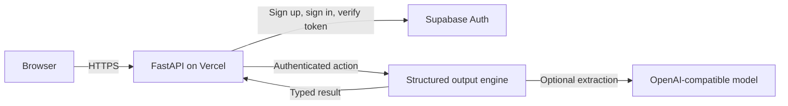
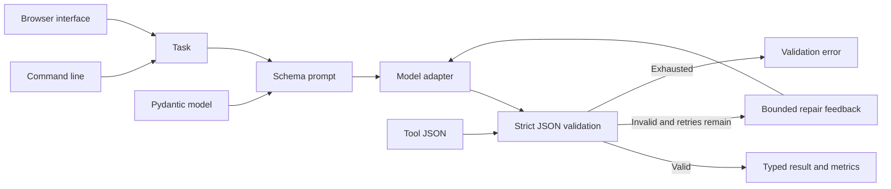

# Structured Output Agent

## About

This app turns messy text into data your software can use. Give it a task and a list of fields, such as a support ticket's title and priority, and it asks a model for JSON that matches those fields. If the response has the wrong shape or type, the app explains the validation error to the model and retries a limited number of times. You receive the validated value and a record of how many attempts it took.

You can also paste JSON and validate it without calling a model. That is useful when you need to check a tool response or an imported record before it reaches the rest of your system.

### What you can do

- Extract typed fields from notes, tickets, and other text.
- Check existing JSON against `str`, `int`, `float`, and `bool` fields.
- See validation failures and retry counts when an extraction is difficult.
- Use the [hosted app](https://structured-output-agent.vercel.app/), the CLI, the local browser, or the Python library.

The hosted app uses email and password accounts. Validation runs without a model call; extraction uses the configured provider. A valid schema does not prove that the extracted facts are correct, so review important values against their source.

## Quick start

Requires Python 3.11 or newer. From this repository:

```powershell
python -m venv .venv
.\.venv\Scripts\Activate.ps1
python -m pip install -e '.[dev]'
pytest -q
```

On macOS or Linux:

```bash
python3 -m venv .venv
source .venv/bin/activate
python -m pip install -e '.[dev]'
pytest -q
```

For live model calls, set `OPENAI_API_KEY` and optionally `OPENAI_MODEL` and `OPENAI_BASE_URL` as shown in `.env.example`. The test suite uses stubs and needs no model key.

Install the package, then use `structured-output extract "Summarize this support ticket..." --field title:str --field priority:int` to get typed JSON. Use `structured-output validate '{"title":"Bug","priority":2}' --field title:str --field priority:int` to validate locally without a model call. For a browser form, run `structured-output serve --port 8080` and open `http://127.0.0.1:8080`. The browser lets you define `str`, `int`, `float`, or `bool` fields and either extract or validate data.

```python
from pydantic import BaseModel, Field
from structured_output_agent.engine import StructuredOutputAgent
from structured_output_agent.llm import OpenAICompatibleLLM


class Invoice(BaseModel):
    amount: float = Field(gt=0)
    currency: str = Field(pattern=r"^[A-Z]{3}$")


result = StructuredOutputAgent(OpenAICompatibleLLM.from_env(), Invoice).run(
    "Extract: USD 42.50"
)
print(result.value, result.attempts, result.validation_failures)
```

## Architecture

The hosted application uses Supabase Auth for email/password sessions. Its API verifies each access token with Supabase before running a product action.





| Component | Responsibility |
|---|---|
| Schema boundary | Pydantic validates model and tool JSON with strict types. |
| Repair controller | Retries only a configured number of times with bounded feedback. |
| Event sink | Emits outcome and timing without raw model content. |

Caller -> schema JSON in system prompt -> model -> Pydantic validation -> bounded repair prompt -> typed result or OutputValidationError.

See [ARCHITECTURE.md](ARCHITECTURE.md) for components, state, failure behavior, and operations.

## Deployment and safety

The hosted interface is at [structured-output-agent.vercel.app](https://structured-output-agent.vercel.app/). See [DEPLOYMENT.md](DEPLOYMENT.md) for Vercel/Supabase setup, the non-root container option, and release checks. Model-backed extraction requires an `OPENAI_API_KEY` in Vercel; schema validation works without it.

Schema checks constrain shape and values. The caller should still validate business facts against a trusted source. Invalid responses are truncated before being placed in retry prompts.

Install this as a library in an authenticated application or worker. Supply the LLM adapter through dependency injection. Keep secrets in environment variables, never in source control.

## Verification

`pytest -q` runs deterministic tests. GitHub Actions runs the same suite on pushes and pull requests.

## Product guide

### Pick the right action

| Action | Give it | Get back | Model call |
|---|---|---|---|
| `extract` | A task or source text, plus fields written as `name:type` | A JSON object whose fields passed strict type validation, with attempt counts | Yes |
| `validate` | Existing JSON plus the same field definition | The parsed, typed value or a validation error | No |

For example, enter `title:str` and `priority:int` on separate lines, then paste a support ticket. If the model returns `"priority":"high"`, the parser rejects it because `priority` must be an integer. The retry prompt includes that concrete problem; after the configured retry limit, the action fails visibly instead of passing bad JSON downstream.

### Where the work runs

- **Hosted web app:** A signed-in user submits a form over HTTPS. The FastAPI endpoint verifies the Supabase session and runs the selected action. The account lives in Supabase Auth; extraction inputs and outputs are not stored in this app's database.
- **Local browser:** Start `structured-output serve --port 8080`. This is an operator interface on your machine, with the same extract and validate actions.
- **CLI and library:** Use the `structured-output` command in scripts, or import `StructuredOutputAgent` with your own Pydantic model for richer rules such as ranges and patterns.

### Configuration

| Variable | Needed for | Purpose |
|---|---|---|
| `OPENAI_API_KEY` | Model-backed extraction | Server-side credential for an OpenAI-compatible chat API. |
| `OPENAI_BASE_URL` | Non-default provider | HTTPS API base URL. |
| `OPENAI_MODEL` | Model-backed extraction | Chat model identifier at that provider. |
| `SUPABASE_URL` and `SUPABASE_PUBLISHABLE_KEY` | Hosted app | Account sign-in and session verification. |

Set credentials through Vercel environment variables or your local shell, never in a committed file. `validate` does not need a model key. The hosted app uses Secure, HttpOnly cookies and checks the request origin before mutating actions.

### Failure behavior and operations

Invalid fields and JSON return a clear validation error. A model outage returns an unavailable response; it does not turn an invalid result into a valid one. A successful type check only establishes the shape and field constraints. For important business decisions, compare extracted facts with the original document or another trusted source.

Before sharing a deployment, run the unit tests and `scripts/smoke_hosted.py`, which signs in with a temporary account, validates JSON, runs a real extraction, and removes the account. Check `/healthz`, sign-in, and the extract and validate forms after a deploy. The hosted app currently relies on a limited model account, so configure capacity and usage controls before broad public traffic. See [DEPLOYMENT.md](DEPLOYMENT.md) and [SECURITY.md](SECURITY.md) for the full release notes.

### Common issues

| Symptom | Check |
|---|---|
| `validate` rejects a number written as a string | Strict validation keeps `"2"` distinct from `2`; fix the input or choose the intended field type. |
| `extract` reports a provider error | Confirm the server-side key, base URL, model ID, and provider quota. |
| A hosted action asks you to sign in | Refresh the session or sign in again; browser actions require an account. |
| A field is missing after extraction | Add it to the schema and make the extraction instruction explicit. |

For application code, catch `OutputValidationError` and decide whether to ask for a corrected input, log a failed extraction, or hand it to a reviewer. Do not silently substitute an unvalidated model response.

## License

MIT. See [LICENSE](LICENSE).
